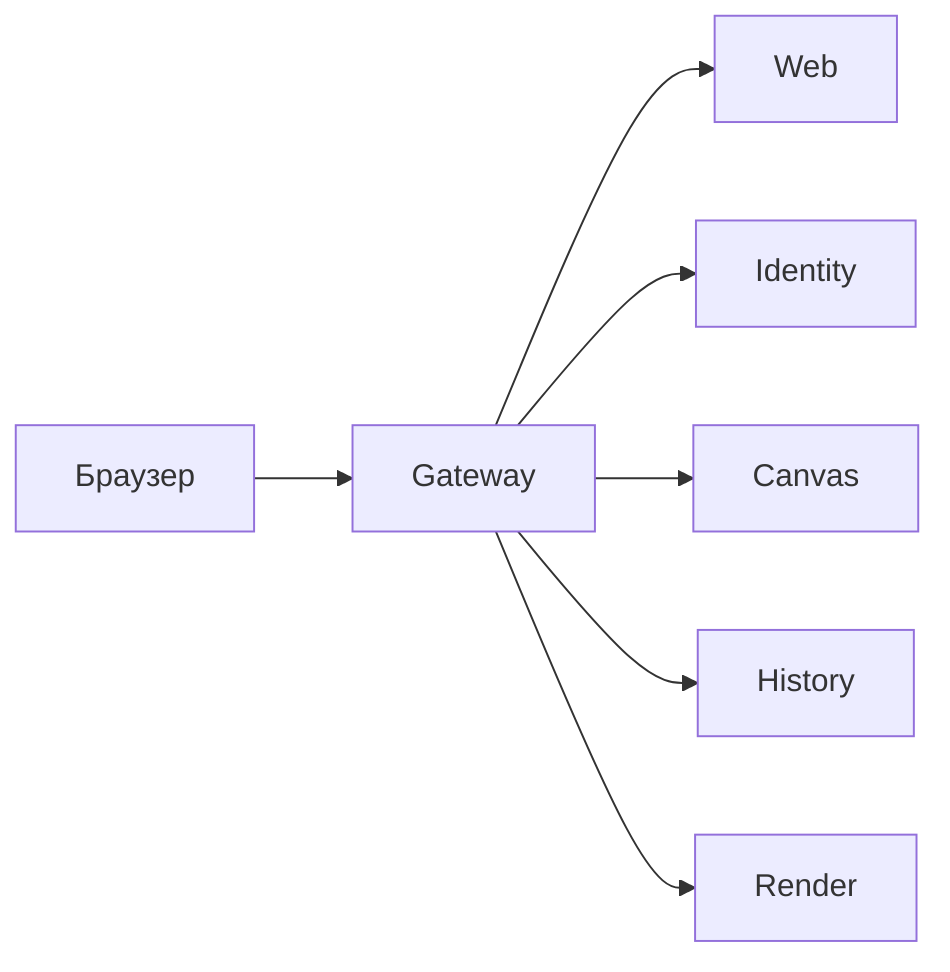

# Stena

Общая пиксельная стена в реальном времени, аналог Pixel Battle от ВК и r/place. Игроки ставят пиксели с cooldown'ом, изменения сразу видят все, администратор откатывает испорченные области.

## Технологический стек

.NET 10, ASP.NET Core, EF Core, PostgreSQL 18, Redis 8, RabbitMQ 4 и MassTransit 8.5, SignalR, YARP, SkiaSharp и ffmpeg. Веб клиент на SvelteKit 3 и Tailwind CSS. Docker Compose.

## Архитектура

Шлюз принимает все запросы на порту 8080. Identity отвечает за вход и баны, Canvas за стены, пиксели и откат, History за журнал пикселей, Render за изображения и таймлапс. Подробно: [docs/ARCHITECTURE.md](docs/ARCHITECTURE.md).

## Быстрый старт

Требования: Docker.

1. Скопировать `.env.example` в `.env`. Пароли и ключ JWT в нём можно заменить своими до первого запуска.
2. Запустить: `docker compose up --build`
3. Открыть http://localhost:8080

Описание API: http://localhost:8080/scalar

Тестовые учётные записи: `admin@stena.test` / `admin123` (администратор), `player@stena.test` / `player123` (игрок).

Боты рисуют логотип на стене 1: `dotnet run --project backend/tools/Stena.Bots -- --wall 1 --bots 20`, нужен .NET 10 SDK.

## Реализованная функциональность

- Регистрация и вход, роли игрок и администратор.
- Стены: администратор создаёт и меняет их. Размер, палитра и начало фиксируются после старта.
- Установка пикселя тратит заряд. Заряд копится по cooldown'у стены, повтор запроса не ставит пиксель дважды.
- Все зрители видят изменения через SignalR, пакетами раз в 100 мс.
- История: кто и когда поставил пиксель, состояние любой области на любой момент.
- Бан игрока и откат области с баном вандала.
- Изображение, миниатюра и таймлапс стены.
- Боты и нагрузочный тест.

## Тесты и CI

Модульные и интеграционные тесты: `dotnet test backend/Stena.slnx`, нужны .NET 10 SDK и Docker.

Сквозные сценарии в браузере проверяют вход, рассылку изменений и откат с баном. При запущенной системе в папке `frontend`: `npm ci`, `npx playwright install chromium`, `npx playwright test`.

Нагрузочный тест при запущенной системе: `dotnet run --project backend/tools/Stena.Load`. Он создаёт стену и 1000 игроков, 30 секунд ставит 1000 пикселей в секунду, затем 10 секунд по 2000. Результат на одной машине: 50 000 пикселей без отказов, история совпала со стеной, задержка p99 от 2,6 до 13,4 мс в трёх запусках. Если хоть один запрос отклонён или история разошлась со стеной по числу пикселей или по их цветам, тест завершается с ошибкой.

## Структура репозитория

- `backend/src`: сервисы Gateway, Identity, Canvas, History, Render и общие проекты Contracts и ServiceDefaults.
- `backend/tests`: тесты сервисов.
- `backend/tools`: боты и нагрузочный тест.
- `frontend`: веб клиент и сквозные сценарии.
- `docs`: план и архитектура.
- `compose.yaml`, `postgres/init.sh`, `.env.example`: запуск всей системы и образец настроек.

## План работ

[docs/PLAN.md](docs/PLAN.md)

## Ограничения и планы развития

Canvas и Redis работают в одном экземпляре, при падении Redis теряется до секунды последних пикселей. Нет модераторов, жалоб и мобильной версии. Подробно: раздел 10 в [docs/ARCHITECTURE.md](docs/ARCHITECTURE.md).
