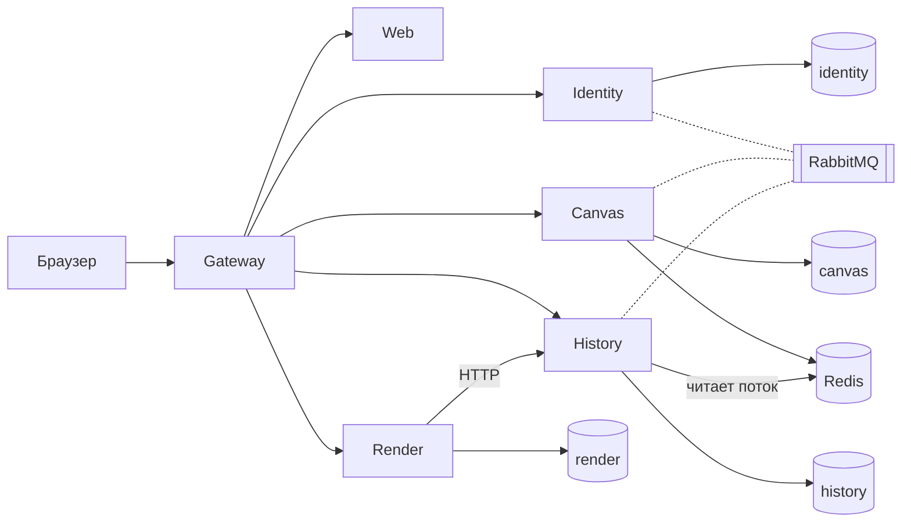
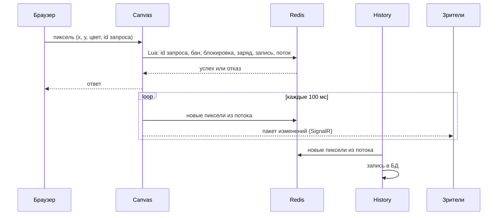
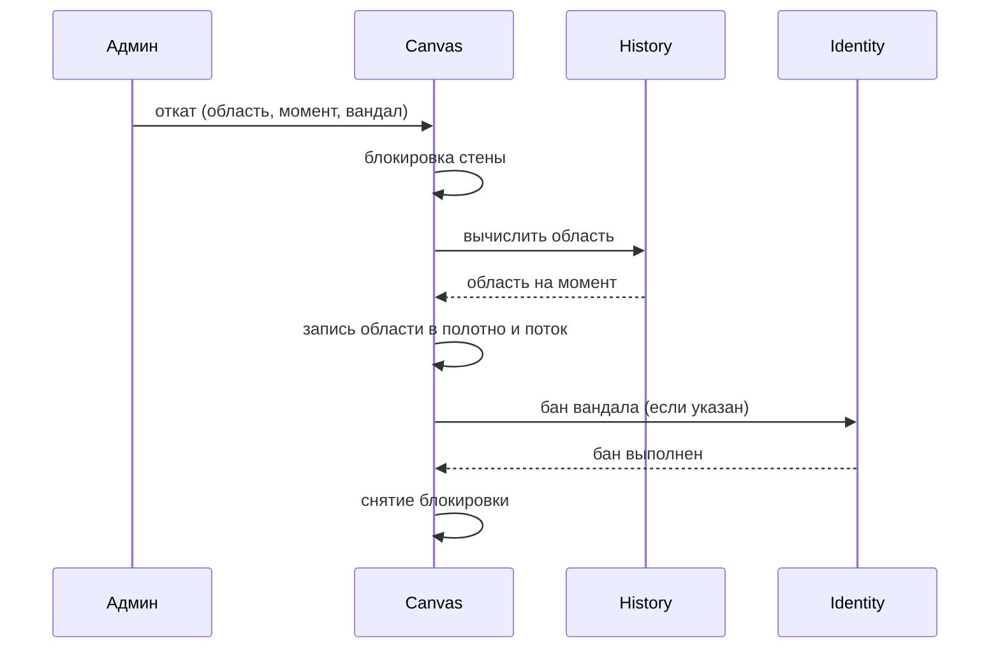

# Архитектура

## 1. Цель и контекст

Общая стена пикселей в реальном времени. Игроки ставят пиксели с cooldown'ом, зрители смотрят без входа, администратор создаёт стены, банит игроков и откатывает испорченные области.

## 2. Требования

- Пиксель ставит только вошедший игрок и тратит на это заряд. Заряд копится раз в 30 секунд, до 10 в запасе.
- Все зрители стены сразу видят изменения.
- Для любого пикселя видно, кто и когда его поставил. Любую область можно восстановить на любой момент.
- Тысячи пикселей в секунду без потерь и повторов.
- Вся система запускается одной командой `docker compose up`.

## 3. Общая схема

Сплошные стрелки: запросы. Пунктир: сообщения через RabbitMQ.

## 4. Сервисы

| Сервис | Отвечает за | API | БД | События |
|---|---|---|---|---|
| Identity | пользователи, вход, роли, баны | регистрация, вход, бан | identity | получает бан от Saga, публикует бан (Outbox) |
| Canvas | стены, установка пикселей, рассылка изменений, откат области | стены (CRUD), полотно, пиксель, мои заряды, откат, хаб SignalR | canvas, Redis | получает бан, ведёт Saga |
| History | журнал пикселей, состояние на момент | кто поставил пиксель, область на момент | history | читает поток пикселей, вычисляет область для Saga |
| Render | изображение стены, миниатюра, таймлапс | изображение, миниатюра, таймлапс | render | нет |

## 5. Модель данных

| Где | Данные |
|---|---|
| identity | users: email, хеш пароля, роль, бан |
| canvas | walls: размер, палитра, cooldown, начало и конец. rollbacks: состояние Saga |
| Redis | полотно стены (байт на пиксель), заряды игроков, id запросов, поток пикселей, кэш банов, блокировка стены на время отката |
| history | pixels: стена, x, y, цвет, игрок, время, id в потоке. snapshots: полотно стены на момент |
| render | timelapses: стена, статус, файл |

## 6. Взаимодействие сервисов

Установка пикселя:

Откат области (Saga, сообщения через RabbitMQ):

Если вычисление или запись не удались, Canvas снимает блокировку без бана. У блокировки есть срок жизни, поэтому она снимается сама, если Canvas упал.

## 7. Безопасность

- Identity выдаёт JWT, каждый сервис проверяет его сам. Роли: игрок и администратор.
- Пароли хранятся только в виде хеша.
- Наружу открыт только шлюз. Сервисы и базы доступны только внутри сети Docker.
- Бан не ждёт истечения токена: Canvas держит кэш банов в Redis и проверяет его при каждой установке.

## 8. Развёртывание и конфигурация

Docker Compose: gateway, web, identity, canvas, history, render, postgres, redis, rabbitmq. Значения для демо заданы в compose, их можно переопределить в `.env`. Наружу открыт порт 8080.

## 9. Принятые решения (ADR)

| Решение | Альтернатива | Почему |
|---|---|---|
| Полотно в Redis, установка одним Lua скриптом | строки в PostgreSQL | атомарно и быстро, без блокировок строк |
| Поток пикселей через Redis Stream | RabbitMQ и Outbox | один Lua скрипт пишет и пиксель, и событие |
| Бан публикуется через Outbox | публикация после сохранения | бан и событие сохраняются одной транзакцией |
| Один PostgreSQL, отдельная база на сервис | контейнер на сервис | меньше контейнеров, у каждого сервиса своя база и свой логин |
| Пакет изменений раз в 100 мс | сообщение на каждый пиксель | число сообщений не растёт с нагрузкой |
| Saga под управлением Canvas | цепочка событий между сервисами | весь откат виден в одном месте |
| Состояние на момент: снимок плюс журнал после него | проход по всему журналу | время не растёт с длиной журнала |

## 10. Ограничения и развитие

- Canvas работает в одном экземпляре.
- Один экземпляр Redis без реплики. При его падении теряется до секунды последних пикселей.
- Один ключ JWT на все сервисы.
- Нет модераторов и жалоб, только администратор.
